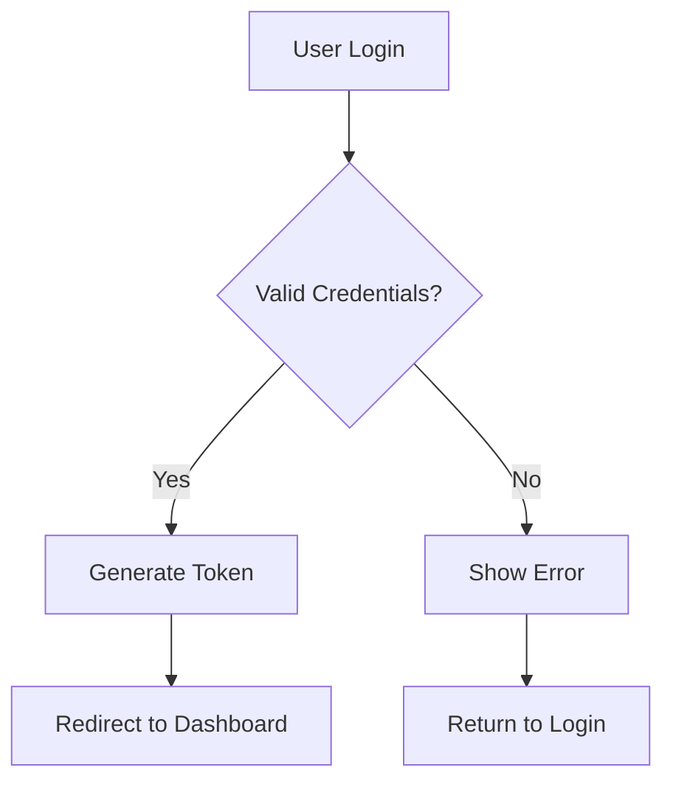
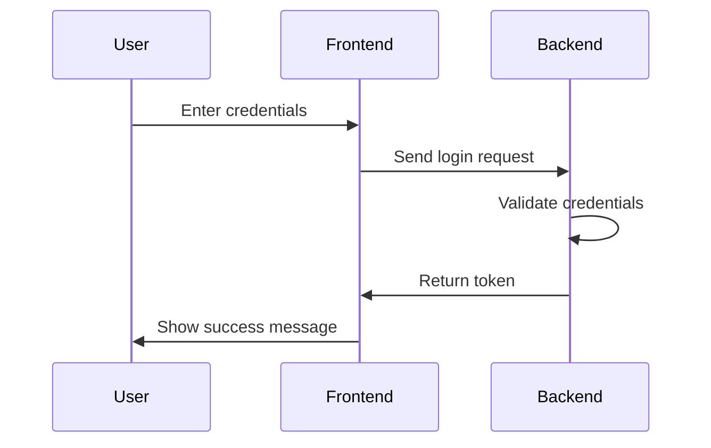

# Mermaid Diagram Tool - Browser Assistant

## Overview
The Mermaid Diagram Tool allows the Browser Assistant to create visual diagrams from Mermaid code. Users can request various types of diagrams, and the assistant will generate the appropriate Mermaid syntax and display it in a formatted container.

## Features

### ✅ **Supported Diagram Types**
- **Flowcharts**: `graph` and `flowchart`
- **Sequence Diagrams**: `sequenceDiagram`
- **Class Diagrams**: `classDiagram`
- **State Diagrams**: `stateDiagram-v2`
- **Entity Relationship Diagrams**: `erDiagram`
- **Journey Diagrams**: `journey`
- **Gantt Charts**: `gantt`
- **Pie Charts**: `pie`
- **Git Graphs**: `gitgraph`

### ✅ **Visual Features**
- **Styled Containers**: Professional-looking diagram containers
- **Code Display**: Mermaid code shown in syntax-highlighted blocks
- **Responsive Design**: Adapts to different screen sizes
- **Scrollable Content**: Large diagrams can be scrolled
- **Error Handling**: Graceful handling of invalid syntax

## How to Use

### **1. Natural Language Prompts**
Users can ask for diagrams using natural language:

```
"Create a flowchart showing the user registration process"
"Draw a sequence diagram for a login process"
"Show me a class diagram for a User class"
"Create a state diagram for order processing"
```

### **2. Direct Mermaid Code**
Users can also provide raw Mermaid code:

```
"Create a diagram with this code:
graph TD
    A[Start] --> B{Decision}
    B -->|Yes| C[Success]
    B -->|No| D[Error]"
```

## Implementation Details

### **Tool Integration**
The Mermaid tool is integrated into the LangGraph agent:

```javascript
// In src/langgraph-agent.js
import { MermaidDiagramTool } from "./mermaid-tool.js";

const mermaidTool = new MermaidDiagramTool();
this.agent = createReactAgent({
  llm: llm,
  tools: [mermaidTool] // Include Mermaid diagram tool
});
```

### **Tool Class Structure**
```javascript
export class MermaidDiagramTool extends Tool {
  constructor() {
    super();
    this.name = "mermaid_diagram";
    this.description = "Create a Mermaid diagram from code...";
  }

  async _call(input) {
    // Validate and process Mermaid code
    // Return formatted HTML for display
  }
}
```

### **Helper Functions**
The tool includes helper functions for common diagram types:

```javascript
export const createMermaidExamples = {
  flowchart: (title, nodes, connections) => { ... },
  sequenceDiagram: (title, participants, messages) => { ... },
  classDiagram: (title, classes) => { ... },
  stateDiagram: (title, states, transitions) => { ... }
};
```

## Styling and Display

### **CSS Classes**
- `.mermaid-diagram`: Main container
- `.mermaid-code`: Code display section
- `.mermaid-render`: Diagram preview section

### **Visual Design**
- **Container**: Rounded borders with subtle shadows
- **Code Block**: Monospace font with syntax highlighting
- **Diagram Preview**: Centered with professional styling
- **Responsive**: Adapts to different screen sizes

## Example Usage

### **Flowchart Example**
**User Prompt**: "Create a flowchart for user authentication"

**Generated Mermaid Code**:


**Display**: The diagram appears in a styled container with the code shown above and a formatted preview below.

### **Sequence Diagram Example**
**User Prompt**: "Show the login process between user, frontend, and backend"

**Generated Mermaid Code**:


## Testing

### **Test Page**
Use `test-mermaid.html` to test the Mermaid diagram functionality:

1. Load the Browser Assistant extension
2. Open `test-mermaid.html` in Chrome
3. Try the example prompts
4. Verify diagrams are rendered correctly

### **Test Prompts**
- "Create a flowchart showing the user registration process"
- "Draw a sequence diagram for a login process"
- "Create a class diagram for a User class"
- "Show the states of an order: pending, confirmed, shipped, delivered"

## Error Handling

### **Validation**
- Checks for valid Mermaid diagram types
- Validates basic syntax structure
- Provides helpful error messages

### **Error Messages**
- "No Mermaid code provided"
- "Invalid Mermaid syntax. Please start with one of these diagram types: ..."
- "Error creating Mermaid diagram: [specific error]"

## Performance Considerations

### **Bundle Size**
- Tool adds minimal overhead (~2KB)
- No external Mermaid.js library required
- Client-side rendering only

### **Rendering**
- Diagrams are displayed as formatted text
- No actual Mermaid.js rendering (would require additional setup)
- Focus on code display and syntax highlighting

## Future Enhancements

### **Potential Improvements**
1. **Actual Mermaid Rendering**: Integrate Mermaid.js for real diagram rendering
2. **Interactive Diagrams**: Make diagrams clickable and interactive
3. **Export Functionality**: Allow users to export diagrams as images
4. **Template Library**: Pre-built diagram templates for common use cases
5. **Real-time Preview**: Live preview as users type Mermaid code

### **Advanced Features**
- **Diagram Validation**: More sophisticated syntax checking
- **Auto-completion**: Suggest Mermaid syntax as users type
- **Theme Support**: Different visual themes for diagrams
- **Collaboration**: Share diagrams with other users

## Troubleshooting

### **Common Issues**
1. **Diagrams not displaying**: Check if the tool is properly integrated
2. **Invalid syntax errors**: Verify Mermaid code follows proper syntax
3. **Styling issues**: Check CSS classes are properly applied
4. **Tool not responding**: Verify the agent is using the correct tools

### **Debug Steps**
1. Check browser console for errors
2. Verify extension is loaded and active
3. Test with simple Mermaid code first
4. Check that the tool is included in the agent's tools array

The Mermaid Diagram Tool provides a powerful way for users to create visual diagrams through natural language interaction with the Browser Assistant!
