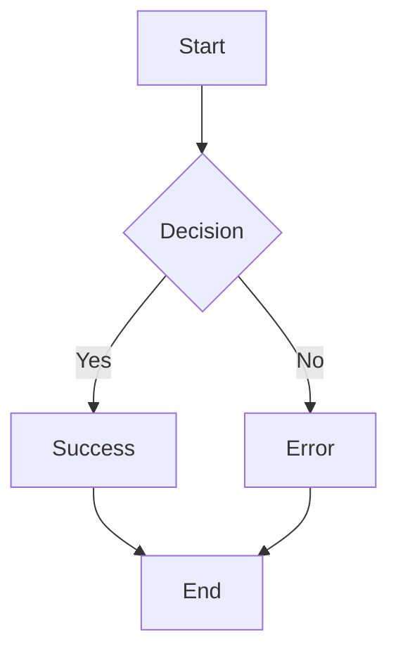
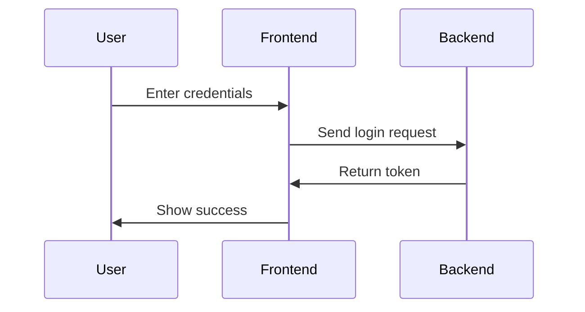
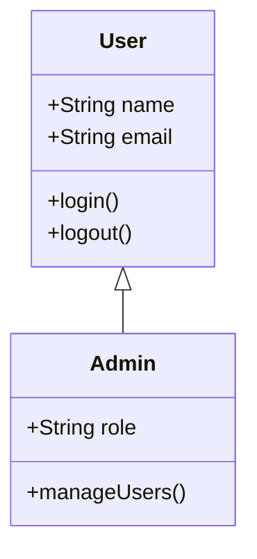
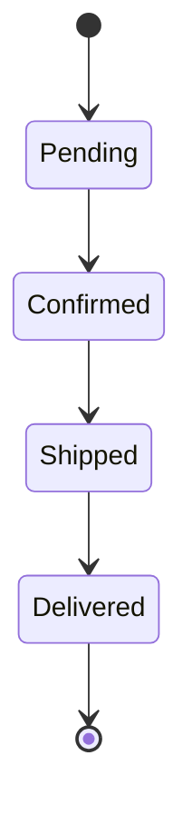
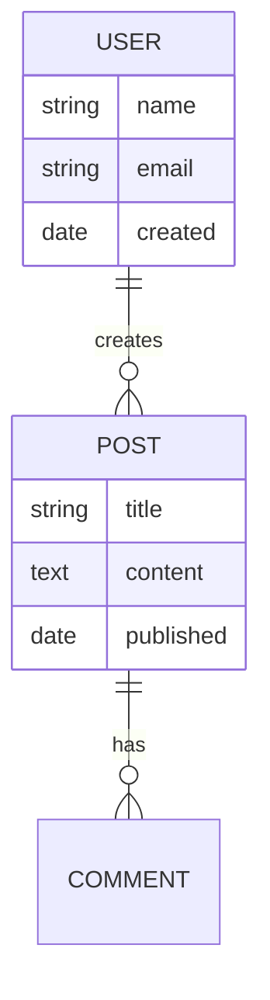

# Mermaid.js Integration - Real Visual Diagrams

## Overview
The Browser Assistant now uses the actual [Mermaid.js library](https://cdn.jsdelivr.net/npm/mermaid/dist/mermaid.min.js) to render real visual diagrams instead of just displaying formatted text. This provides users with actual SVG diagrams that are interactive and professionally styled.

## Key Improvements

### ✅ **Real Visual Rendering**
- **SVG Diagrams**: Actual vector graphics instead of text
- **Interactive Elements**: Clickable and hoverable diagram elements
- **Professional Quality**: High-resolution, scalable diagrams
- **Theme Integration**: Matches the extension's color scheme

### ✅ **Mermaid.js Integration**
- **CDN Loading**: Loads Mermaid.js from [jsdelivr CDN](https://cdn.jsdelivr.net/npm/mermaid/dist/mermaid.min.js)
- **Dynamic Loading**: Only loads when needed to optimize performance
- **Error Handling**: Graceful fallback for loading or rendering errors
- **Theme Customization**: Custom color scheme matching the extension

## Technical Implementation

### **Mermaid.js Loading**
```javascript
// Load Mermaid.js dynamically
if (typeof mermaid === 'undefined') {
  const script = document.createElement('script');
  script.src = 'https://cdn.jsdelivr.net/npm/mermaid/dist/mermaid.min.js';
  script.onload = function() {
    mermaid.initialize({ 
      startOnLoad: false,
      theme: 'default',
      themeVariables: {
        primaryColor: '#007bff',
        primaryTextColor: '#333',
        primaryBorderColor: '#007bff',
        lineColor: '#333',
        secondaryColor: '#f8f9fa',
        tertiaryColor: '#fff'
      }
    });
    // Render the diagram
  };
  document.head.appendChild(script);
}
```

### **Diagram Rendering**
```javascript
// Render the specific diagram
mermaid.render('diagram-id', mermaidCode).then(({svg}) => {
  const container = document.getElementById('diagram-container');
  container.innerHTML = svg;
}).catch(err => {
  // Handle rendering errors
  container.innerHTML = '<div class="mermaid-error">Error: ' + err.message + '</div>';
});
```

### **HTML Structure**
```html
<div class="mermaid-diagram">
  <div class="mermaid-code">
    <pre><code>graph TD
    A[Start] --> B[End]</code></pre>
  </div>
  <div class="mermaid-container">
    <div class="mermaid">graph TD
    A[Start] --> B[End]</div>
  </div>
</div>
```

## CSS Styling

### **Container Styling**
```css
.mermaid-diagram {
  margin: 12px 0;
  border: 1px solid #e9ecef;
  border-radius: 8px;
  overflow: hidden;
  background: #fff;
}

.mermaid-container {
  padding: 16px;
  text-align: center;
  background: #fff;
  min-height: 100px;
  display: flex;
  align-items: center;
  justify-content: center;
}
```

### **Mermaid-Specific Styling**
```css
.mermaid svg {
  max-width: 100%;
  height: auto;
}

.mermaid .node rect,
.mermaid .node circle,
.mermaid .node ellipse {
  fill: #f8f9fa;
  stroke: #007bff;
  stroke-width: 2px;
}

.mermaid .edgePath .path {
  stroke: #007bff;
  stroke-width: 2px;
}
```

## Supported Diagram Types

### **1. Flowcharts**


### **2. Sequence Diagrams**


### **3. Class Diagrams**


### **4. State Diagrams**


### **5. Entity Relationship Diagrams**


## User Experience

### **Natural Language Prompts**
Users can ask for diagrams using natural language:
- "Create a flowchart showing the user registration process"
- "Draw a sequence diagram for a login process"
- "Show me a class diagram for a User class"
- "Create a state diagram for order processing"

### **Visual Results**
- **Real Diagrams**: Actual SVG graphics instead of text
- **Professional Styling**: Consistent with the extension theme
- **Responsive Design**: Adapts to different screen sizes
- **Error Handling**: Clear error messages for invalid syntax

## Performance Considerations

### **Optimizations**
- **Dynamic Loading**: Mermaid.js only loads when needed
- **Caching**: Script is cached after first load
- **Lazy Rendering**: Diagrams render only when displayed
- **Error Recovery**: Graceful handling of rendering failures

### **Bundle Size Impact**
- **Minimal Overhead**: Only ~2KB for the tool itself
- **External Library**: Mermaid.js loaded from CDN (not bundled)
- **Efficient Loading**: Single script tag for all diagram types

## Error Handling

### **Loading Errors**
```javascript
// Handle script loading failures
script.onerror = function() {
  container.innerHTML = '<div class="mermaid-error">Failed to load Mermaid.js</div>';
};
```

### **Rendering Errors**
```javascript
// Handle diagram rendering failures
mermaid.render('diagram-id', code).catch(err => {
  container.innerHTML = '<div class="mermaid-error">Error: ' + err.message + '</div>';
});
```

### **Syntax Validation**
```javascript
// Basic syntax validation before rendering
const validMermaidTypes = [
  'graph', 'flowchart', 'sequenceDiagram', 'classDiagram', 
  'stateDiagram', 'erDiagram', 'journey', 'gantt', 'pie', 'gitgraph'
];
```

## Testing

### **Test Page**
Use `test-mermaid.html` to test the new Mermaid.js integration:

1. **Load Extension**: Reload the Browser Assistant extension
2. **Open Test Page**: Navigate to `test-mermaid.html`
3. **Try Examples**: Use the provided test prompts
4. **Verify Rendering**: Check that diagrams render as actual SVG graphics

### **Test Prompts**
- "Create a flowchart showing the user registration process"
- "Draw a sequence diagram for a login process"
- "Create a class diagram for a User class"
- "Show the states of an order: pending, confirmed, shipped, delivered"

## Browser Compatibility

### **Supported Browsers**
- **Chrome**: Full support with all features
- **Firefox**: Full support with all features
- **Safari**: Full support with all features
- **Edge**: Full support with all features

### **Requirements**
- **JavaScript**: Required for Mermaid.js functionality
- **SVG Support**: Required for diagram rendering
- **Internet Connection**: Required for CDN loading

## Future Enhancements

### **Potential Improvements**
1. **Offline Support**: Bundle Mermaid.js for offline use
2. **Custom Themes**: More theme options and customization
3. **Export Features**: Save diagrams as images or PDFs
4. **Interactive Elements**: Clickable diagram elements
5. **Animation**: Animated diagram transitions

### **Advanced Features**
- **Diagram Templates**: Pre-built templates for common use cases
- **Collaborative Editing**: Real-time diagram collaboration
- **Version Control**: Track diagram changes over time
- **Integration**: Connect with other diagramming tools

The Mermaid.js integration provides a professional, visual diagramming experience that enhances the Browser Assistant's capabilities for documentation, process flows, and system architecture visualization!
