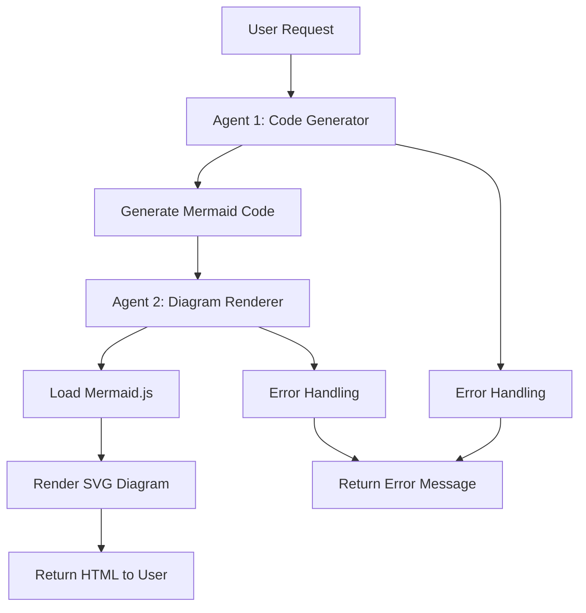
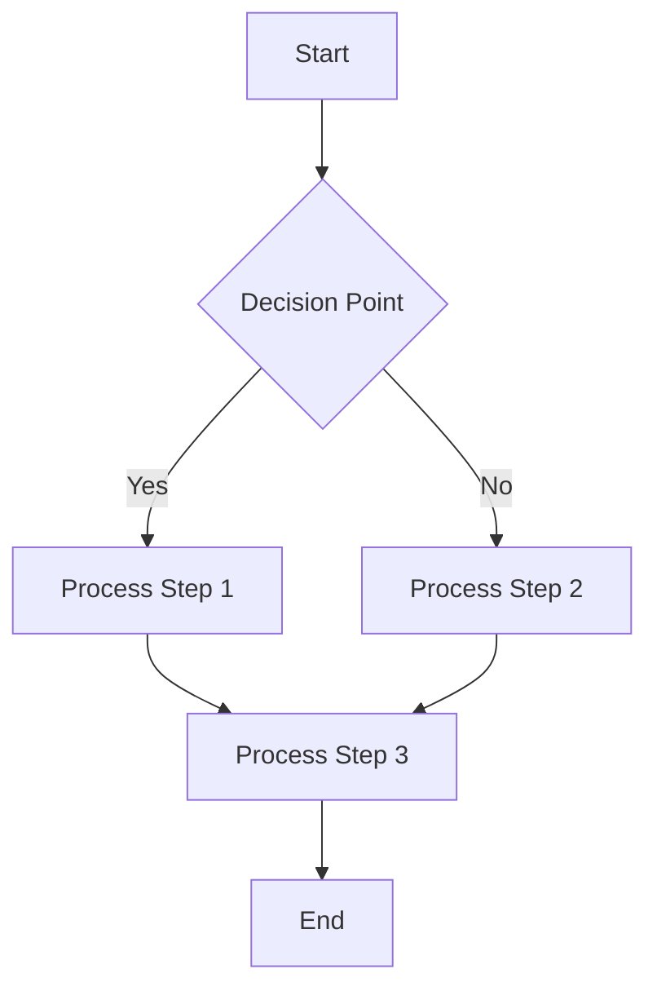
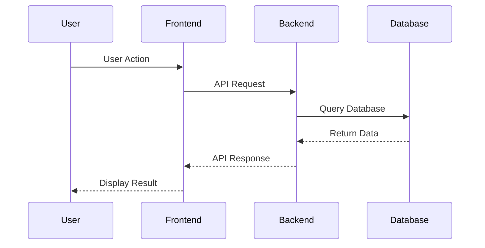
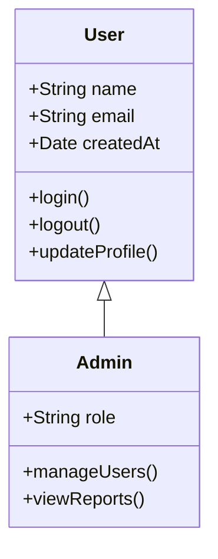
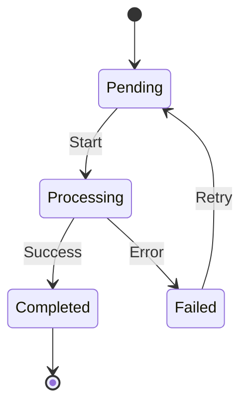
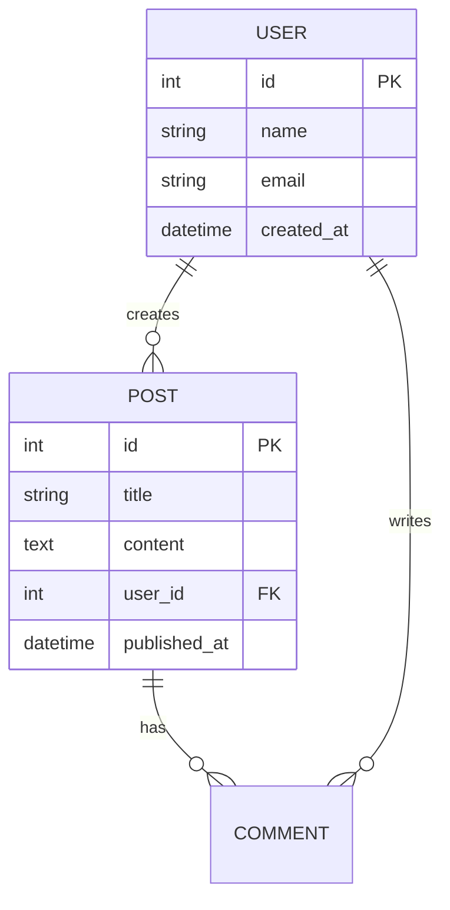

# Multi-Agent Mermaid System - Browser Assistant

## Overview
The Browser Assistant now features a sophisticated multi-agent system for Mermaid diagram generation and rendering. This system uses two specialized agents working together to provide a more robust and modular approach to diagram creation.

## Architecture

### **Agent 1: Mermaid Code Generator**
- **Purpose**: Analyzes user requirements and generates appropriate Mermaid diagram code
- **Tool Name**: `generate_mermaid_code`
- **Input**: Natural language description of desired diagram
- **Output**: Structured Mermaid code with metadata

### **Agent 2: Mermaid Diagram Renderer**
- **Purpose**: Takes generated Mermaid code and creates visual HTML diagrams
- **Tool Name**: `render_mermaid_diagram`
- **Input**: Mermaid diagram code
- **Output**: HTML with embedded Mermaid.js rendering

### **Multi-Agent Coordinator**
- **Purpose**: Orchestrates the workflow between agents
- **Functionality**: Manages the two-step process and error handling

## Workflow



## Implementation Details

### **Agent 1: MermaidCodeGenerator**

```javascript
export class MermaidCodeGenerator extends Tool {
  constructor() {
    super();
    this.name = "generate_mermaid_code";
    this.description = "Generate Mermaid diagram code based on user requirements...";
  }

  async _call(input) {
    // Analyze user input and generate appropriate Mermaid code
    const mermaidCode = await this.generateMermaidCode(description);
    return {
      success: true,
      mermaidCode: mermaidCode,
      description: description,
      message: "Mermaid code generated successfully..."
    };
  }
}
```

**Features:**
- **Intelligent Analysis**: Determines diagram type from user description
- **Template Generation**: Creates appropriate Mermaid syntax
- **Error Handling**: Validates input and provides helpful errors
- **Structured Output**: Returns metadata along with code

### **Agent 2: MermaidDiagramRenderer**

```javascript
export class MermaidDiagramRenderer extends Tool {
  constructor() {
    super();
    this.name = "render_mermaid_diagram";
    this.description = "Render Mermaid diagram code into HTML with visual diagram...";
  }

  async _call(input) {
    // Take Mermaid code and create visual HTML diagram
    const mermaidHtml = this.createRenderedDiagram(mermaidCode);
    return mermaidHtml;
  }
}
```

**Features:**
- **Dynamic Loading**: Loads Mermaid.js only when needed
- **Visual Rendering**: Creates actual SVG diagrams
- **Error Recovery**: Handles rendering failures gracefully
- **Enhanced UI**: Includes copy functionality and loading states

### **Multi-Agent Coordinator**

```javascript
export class MermaidMultiAgent {
  constructor() {
    this.codeGenerator = new MermaidCodeGenerator();
    this.diagramRenderer = new MermaidDiagramRenderer();
  }

  async processRequest(userInput) {
    // Step 1: Generate Mermaid code
    const codeResult = await this.codeGenerator._call(userInput);
    
    // Step 2: Render the diagram
    const diagramResult = await this.diagramRenderer._call(codeResult.mermaidCode);
    
    return diagramResult;
  }
}
```

## Supported Diagram Types

### **1. Flowcharts**
**Trigger Keywords**: flowchart, flow, process


### **2. Sequence Diagrams**
**Trigger Keywords**: sequence, interaction


### **3. Class Diagrams**
**Trigger Keywords**: class, object, uml


### **4. State Diagrams**
**Trigger Keywords**: state, status


### **5. Entity Relationship Diagrams**
**Trigger Keywords**: entity, relationship, database


## User Experience

### **Natural Language Input**
Users can request diagrams using natural language:
- "Create a flowchart showing the user registration process"
- "Draw a sequence diagram for a login process"
- "Show me a class diagram for a User class"
- "Create a state diagram for order processing"

### **Two-Step Process**
1. **Code Generation**: Agent 1 analyzes the request and generates Mermaid code
2. **Visual Rendering**: Agent 2 takes the code and creates the visual diagram

### **Enhanced Features**
- **Copy Functionality**: Users can copy generated Mermaid code
- **Loading States**: Visual feedback during diagram rendering
- **Error Handling**: Clear error messages for each step
- **Professional Styling**: Consistent with extension theme

## Technical Benefits

### **Separation of Concerns**
- **Code Generation**: Focused on understanding user intent and creating appropriate syntax
- **Visual Rendering**: Focused on creating beautiful, interactive diagrams
- **Modularity**: Each agent can be updated independently

### **Error Handling**
- **Granular Errors**: Specific error messages for each step
- **Recovery**: If one agent fails, the other can still provide value
- **Debugging**: Easier to identify which part of the process failed

### **Performance**
- **Lazy Loading**: Mermaid.js only loads when needed
- **Caching**: Generated code can be reused
- **Parallel Processing**: Agents can work independently

## Integration with LangGraph

### **Tool Registration**
```javascript
const mermaidMultiAgent = new MermaidMultiAgent();
const mermaidTools = mermaidMultiAgent.getTools();
this.agent = createReactAgent({
  llm: llm,
  tools: mermaidTools // Both agents registered as tools
});
```

### **Agent Communication**
- **Direct Communication**: Agents can call each other directly
- **Structured Data**: JSON objects passed between agents
- **Error Propagation**: Errors are properly handled and reported

## Testing

### **Test Page**
Use `test-multi-agent.html` to test the multi-agent system:

1. **Load Extension**: Reload the Browser Assistant extension
2. **Open Test Page**: Navigate to `test-multi-agent.html`
3. **Try Examples**: Use the provided test prompts
4. **Observe Flow**: Watch the two-step process in action

### **Test Scenarios**
- **End-to-End**: Complete user request to visual diagram
- **Individual Agents**: Test each agent separately
- **Error Handling**: Test error scenarios for each agent
- **Performance**: Test with various diagram types and sizes

## Debugging

### **Console Logging**
```javascript
console.log('MermaidMultiAgent: Processing request:', userInput);
console.log('MermaidMultiAgent: Step 1 - Generating Mermaid code...');
console.log('MermaidMultiAgent: Step 2 - Rendering diagram...');
```

### **Error Tracking**
- **Agent-Specific Errors**: Each agent logs its own errors
- **Workflow Errors**: Coordinator tracks overall process
- **User Feedback**: Clear error messages for users

## Future Enhancements

### **Potential Improvements**
1. **LLM Integration**: Use actual LLM for smarter code generation
2. **Template Library**: Pre-built templates for common diagram types
3. **Customization**: User preferences for diagram styles
4. **Collaboration**: Multiple users working on diagrams
5. **Version Control**: Track diagram changes over time

### **Advanced Features**
- **Interactive Diagrams**: Clickable elements and animations
- **Export Options**: Save diagrams in various formats
- **Integration**: Connect with other diagramming tools
- **AI Assistance**: Smart suggestions for diagram improvements

The multi-agent system provides a robust, modular, and extensible foundation for Mermaid diagram generation in the Browser Assistant!
